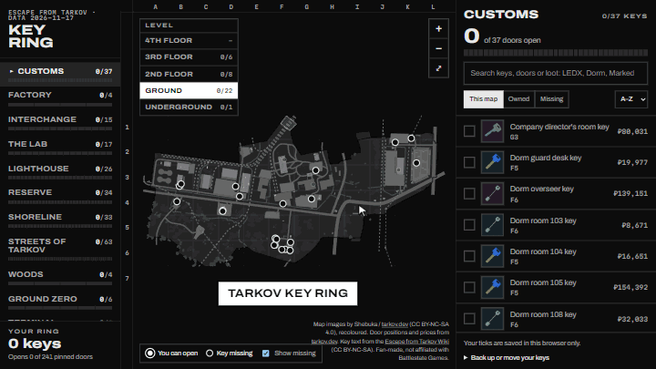

# Tarkov Key Ring

A free fan tool for Escape from Tarkov. Tick the keys you own, and the map shows every locked door you can open, what loot is behind it and where to find each key.

**Open it:** https://mrbreachie.github.io/key-cache/



## What it does

- **259 keys and keycards, 241 doors pinned** across 11 maps: Customs, Factory, Interchange, The Lab, Lighthouse, Reserve, Shoreline, Streets of Tarkov, Woods, Ground Zero and Terminal.
- **Your keys, your doors:** each map lists how many of its doors you can open. Doors you have a key for show as solid white pins; the rest are hollow rings.
- **Floors:** maps with several levels have a floor picker. Pins on other floors are drawn small and faded.
- **Grid references:** rulers around the map give every door a reference such as `F6`, which also shows in the key list.
- **Key details:** what's behind the door, where the door is, where to find the key, quests that use it, and the average flea price.
- **Search** across key names, door locations and loot, for example "LEDX".
- **Saved in your browser:** your ticks are kept in this browser only. Use "Back up or move your keys" to copy them to another browser or device.

The design is greyscale and readable without colour vision. Every state is shown by brightness, shape or pattern, never by colour alone.

## Updating the data

Needs Node 18 or newer.

```sh
node scripts/fetch-wiki.mjs           # key text from the wiki
node scripts/build-data.mjs --refresh # door positions, items and prices from tarkov.dev
```

Then commit `site/` and push. The GitHub Action publishes the site; it doesn't call any API itself.

The scripts are polite to the services they use:

- **24-hour limit:** each source is downloaded at most once every 24 hours, and a run within that window uses the saved copy. `--force` overrides the limit.
- **Safe downloads:** a new download replaces the saved copy only once it's complete and valid, so a failed download never breaks the cache.
- **Icons once:** key icons are downloaded once and kept in `site/icons/`.

## How it's built

- `scripts/fetch-wiki.mjs` reads the wiki's Keys and Keycards categories.
- `scripts/build-data.mjs` joins the wiki text with the tarkov.dev data and writes `site/data.js`, `site/icons.js` and `site/maps/*.js`.
- `site/index.html` is the whole app: one file of HTML, CSS and JavaScript, with no framework and no build step.

Door positions use the same projection as tarkov.dev. The Lab's map image has no published bounds, so its pins use a correction fitted to the locked-door marks in the image.

## Credits and licences

- **Code** (`site/index.html`, `scripts/`): MIT, see [LICENSE](LICENSE).
- **Map images:** by Shebuka for [tarkov.dev](https://github.com/the-hideout/tarkov-dev-svg-maps), CC BY-NC-SA 4.0. They're recoloured here, and the recoloured versions use the same licence.
- **Key text:** [Escape from Tarkov Wiki](https://escapefromtarkov.fandom.com), CC BY-NC-SA.
- **Door positions, items, prices and icons:** [tarkov.dev](https://tarkov.dev).

Because the map images and wiki text are non-commercial, the site must stay free, with no ads and no paywall.

Escape from Tarkov belongs to Battlestate Games. This is a fan project and isn't affiliated with Battlestate Games.
