# Key Cache key ledger

Every Escape from Tarkov key and keycard Key Cache knows (259), so a screenshot of your keys can be turned into an import code for https://mrbreachie.github.io/key-cache/

## How to make an import code

1. Match each key in the screenshot to a row below. In the stash, the game prints the **short name** on the item; compare the **icon** too, especially for rows marked *shared name*.
2. Write `KC:` followed by the **numbers** (first column) of the matching keys, separated by commas, for example `KC: 1, 2, 3`. That is the whole code: no encoding needed.
3. On the site open **Menu > Back up or move your keys**, paste the code and press **Add to my keys** (keeps keys already ticked) or **Restore** (replaces them).

The import box also accepts a plain list of numbers, ids, exact key names or short names, one per line or separated by commas. Numbers are the safest: some short names are shared. Older base64 codes still work.

Machine-readable version: [assets/keys.json](assets/keys.json). Page version with icons: https://mrbreachie.github.io/key-cache/ledger.html

| No. | Icon | Short name (in stash) | Key | Maps | Id |
|---|---|---|---|---|---|
| 1 |  | Negotiations | "Negotiation" room key | Streets of Tarkov | `6582dbe43a2e5248357dbe9a` |
| 2 | 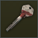 | Aband. | Abandoned factory marked key | Streets of Tarkov | `63a3a93f8a56922e82001f5d` |
| 3 |  | RFID act. | Activated Kruglov's RFID keycard | Shoreline | `67bdf04d66ca1d79a2024637` |
| 4 |  | Admin | Admin's key | The Lab | `6a33c17933cff6b88c08902e` |
| 5 |  | Apt. safe | Apartment locked room safe key | – | `63a39ddda3a2b32b5f6e007a` |
| 6 |  | Archives | Archive room key | Streets of Tarkov | `63a39e49cd6db0635c1975fc` |
| 7 | 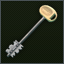 | Ariadne | Ariadne symbol key | The Labyrinth | `67e183377c6c2011970f3149` |
| 8 |  | Aspect | Aspect company office key | Streets of Tarkov | `64ce572331dd890873175115` |
| 9 | 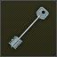 | Hideout | Backup hideout key | Streets of Tarkov | `6398fd8ad3de3849057f5128` |
| 10 | 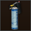 | BBQ-S43 | BBQ-S43 gas torch | The Labyrinth, Icebreaker | `67ab3d4b83869afd170fdd3f` |
| 11 |  | Beluga | Beluga restaurant director key | Streets of Tarkov | `64ccc1fe088064307e14a6f7` |
| 12 | 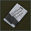 | BD | Black Division keycard | Terminal | `6866ad3853330f9b83064cf9` |
| 13 | 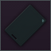 | Blank RFID | Blank RFID keycard | – | `67c031b79320f644db06f456` |
| 14 | 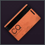 | CQ | Boreas crew quarters keycard | Icebreaker | `69bb3ec9f609db77390b0e1a` |
| 15 | 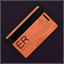 | ER | Boreas engine room keycard | Icebreaker | `69bb3e54d6c67f6265004ab9` |
| 16 |  | LexOs sect. | Car dealership closed section key | Streets of Tarkov | `63a397d3af870e651d58e65b` |
| 17 |  | LexOs | Car dealership director's office room key | Streets of Tarkov | `63a399193901f439517cafb6` |
| 18 | 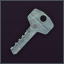 | Cardinal | Cardinal apartment key | Streets of Tarkov | `68c165f1903341d88b092b2a` |
| 19 |  | Container | Cargo container mesh door key | Streets of Tarkov | `63a39fdf1e21260da44a0256` |
| 20 | 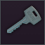 | Chek. 15 | Chekannaya 15 apartment key | Streets of Tarkov | `63a39fc0af870e651d58e6ae` |
| 21 |  | Cold | Cold storage room key | Lighthouse | `61a6446f4b5f8b70f451b166` |
| 22 |  | Company | Company director's room key | Customs | `6761a6f90575f25e020816a4` |
| 23 | 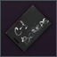 | С-1 | Compartment C-1 keycard | Icebreaker | `69bb3f278af9f360ee010a7a` |
| 24 | 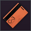 | C-3 | Compartment C-3 keycard | Icebreaker | `69bb3f7df94327bc0f0230c9` |
| 25 |  | Conc 34 | Concordia apartment 34 room key | Streets of Tarkov | `64ccc1d4a0f13c24561edf27` |
| 26 |  | Conc 63 | Concordia apartment 63 room key | Streets of Tarkov | `64ccc1f4ff54fb38131acf27` |
| 27 |  | Conc 64 | Concordia apartment 64 key | Streets of Tarkov | `63a71e922b25f7513905ca20` |
| 28 |  | Conc off. | Concordia apartment 64 office room key | Streets of Tarkov | `63a71e86b7f4570d3a293169` |
| 29 | 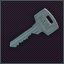 | Cinema | Concordia apartment 8 home cinema key | Streets of Tarkov | `64ccc1ec1779ad6ba200a137` |
| 30 |  | Conc 8 | Concordia apartment 8 room key | Streets of Tarkov | `63a71e781031ac76fe773c7d` |
| 31 |  | Conc sec. | Concordia security room key | Streets of Tarkov | `63a39c7964283b5e9c56b280` |
| 32 |  | Conf. | Conference room key | Lighthouse | `62987cb98081af308d7558c8` |
| 33 |  | Construct. | Construction site bunkhouse key | Streets of Tarkov | `63a39cb1c9b3aa4b61683ee2` |
| 34 |  | Store *(shared name)* | Convenience store storage room key | Lighthouse | `61a64428a8c6aa1b795f0ba1` |
| 35 | 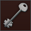 | Corpses | Corpse room key | The Labyrinth | `679bab714e9ca6b3d80586b4` |
| 36 | 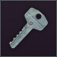 | Cottage | Cottage back door key | Shoreline | `5a0eb6ac86f7743124037a28` |
| 37 |  | Safe *(shared name)* | Cottage safe key | Shoreline | `5a0f068686f7745b0d4ea242` |
| 38 |  | Cult victim | Cult victim's apartment key | Streets of Tarkov | `68e96180901b9b10270f1eed` |
| 39 |  | GDesk | Dorm guard desk key | Customs | `59136a4486f774447a1ed172` |
| 40 | 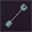 | Overseer | Dorm overseer key | Customs | `664d4b0103ef2c61246afb56` |
| 41 |  | Dorm 103 | Dorm room 103 key | Customs | `5938994586f774523a425196` |
| 42 |  | Dorm 104 | Dorm room 104 key | Customs | `591383f186f7744a4c5edcf3` |
| 43 |  | Dorm 105 | Dorm room 105 key | Customs | `591382d986f774465a6413a7` |
| 44 |  | Dorm 108 | Dorm room 108 key | Customs | `5914578086f774123569ffa4` |
| 45 |  | Dorm 110 | Dorm room 110 key | Customs | `59136e1e86f774432f15d133` |
| 46 |  | Dorm 114 | Dorm room 114 key | Customs | `59387a4986f77401cc236e62` |
| 47 |  | Dorm 118 | Dorm room 118 key | Customs | `5672c92d4bdc2d180f8b4567` |
| 48 |  | Dorm 203 | Dorm room 203 key | Customs | `5938504186f7740991483f30` |
| 49 | 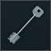 | Dorm 204 | Dorm room 204 key | Customs | `59148c8a86f774197930e983` |
| 50 | 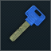 | Dorm 206 | Dorm room 206 key | Customs | `5938603e86f77435642354f4` |
| 51 |  | Dorm 214 | Dorm room 214 key | Customs | `5780cf942459777df90dcb72` |
| 52 |  | Dorm 218 | Dorm room 218 key | Customs | `5780cf9e2459777df90dcb73` |
| 53 |  | Dorm 220 | Dorm room 220 key | Customs | `5780cfa52459777dfb276eb1` |
| 54 |  | Dorm 303 | Dorm room 303 key | Customs | `593aa4be86f77457f56379f8` |
| 55 |  | Dorm 306 | Dorm room 306 key | Customs | `5780cda02459777b272ede61` |
| 56 |  | Dorm 308 | Dorm room 308 key | Customs | `5780cf722459777a5108b9a1` |
| 57 | 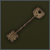 | Dorm 314 | Dorm room 314 marked key | Customs | `5780cf7f2459777de4559322` |
| 58 |  | Dorm 315 | Dorm room 315 key | Customs | `5780cf692459777de4559321` |
| 59 | 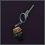 | Elektronik | Elektronik's key | Streets of Tarkov | `68e95d71a3d110355b03e529` |
| 60 |  | EMC | EMERCOM medical unit key | Interchange | `5ad5db3786f7743568421cce` |
| 61 | 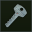 | Factory | Factory emergency exit key | Factory, Lighthouse, Shoreline, Streets of Tarkov, Ground Zero | `5448ba0b4bdc2d02308b456c` |
| 62 |  | Finance | Financial institution office key | Streets of Tarkov | `63a39667c9b3aa4b61683e98` |
| 63 |  | Finance s | Financial institution small office key | Streets of Tarkov | `63a71ed21031ac76fe773c7f` |
| 64 | 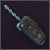 | Car *(shared name)* | Folding car key | Customs | `590de4a286f77423d9312a32` |
| 65 |  | Car *(shared name)* | Folding car key | Customs | `59136f6f86f774447a1ed173` |
| 66 | 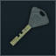 | Gas office | Gas station office key | Customs | `5780d0652459777df90dcb74` |
| 67 |  | Gas safe | Gas station safe key | Shoreline | `5a0f045e86f7745b0f0d0e42` |
| 68 |  | Gas store | Gas station storage room key | Customs | `5913877a86f774432f15d444` |
| 69 |  | Goshan reg. | Goshan cash register key | Interchange | `5ad7247386f7747487619dc3` |
| 70 | 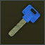 | Grumpy | Grumpy's hideout key | Interchange | `664d3dd590294949fe2d81b7` |
| 71 |  | E107 San | Health Resort east wing office room 107 key | Shoreline | `5a0ea64786f7741707720468` |
| 72 |  | E108 San | Health Resort east wing office room 108 key | Shoreline | `5a0ea69f86f7741cd5406619` |
| 73 |  | E205 San | Health Resort east wing room 205 key | Shoreline | `5a144bdb86f7741d374bbde0` |
| 74 | 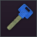 | E206 San | Health Resort east wing room 206 key | Shoreline | `5a0ee4b586f7743698200d22` |
| 75 |  | E209 San | Health Resort east wing room 209 key | Shoreline | `5a0ee62286f774369454a7ac` |
| 76 |  | E213 San | Health Resort east wing room 213 key | Shoreline | `5a0ee72c86f77436955d3435` |
| 77 |  | E216 San | Health Resort east wing room 216 key | Shoreline | `5a0ee76686f7743698200d5c` |
| 78 |  | E222 San | Health Resort east wing room 222 key | Shoreline | `5a13f24186f77410e57c5626` |
| 79 |  | E226 San | Health Resort east wing room 226 key | Shoreline | `5a13f35286f77413ef1436b0` |
| 80 |  | E306 San | Health Resort east wing room 306 key | Shoreline | `5a145d4786f7744cbb6f4a12` |
| 81 |  | E308 San | Health Resort east wing room 308 key | Shoreline | `5a145d7b86f7744cbb6f4a13` |
| 82 |  | E310 San | Health Resort east wing room 310 key | Shoreline | `5a0eec9686f77402ac5c39f2` |
| 83 |  | E313 San | Health Resort east wing room 313 key | Shoreline | `5a0eecf686f7740350630097` |
| 84 |  | E314 San | Health Resort east wing room 314 key | Shoreline | `5a0eed4386f77405112912aa` |
| 85 |  | E316 San | Health Resort east wing room 316 key | Shoreline | `5a145ebb86f77458f1796f05` |
| 86 |  | E322 San | Health Resort east wing room 322 key | Shoreline | `5a0eedb386f77403506300be` |
| 87 |  | E328 San | Health Resort east wing room 328 key | Shoreline | `5a0eee1486f77402aa773226` |
| 88 |  | Safe *(shared name)* | Health Resort management office safe key | Shoreline | `5a0f08bc86f77478f33b84c2` |
| 89 |  | Safe *(shared name)* | Health Resort management warehouse safe key | Shoreline | `5a0f0f5886f7741c4e32a472` |
| 90 | 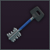 | San tape | Health Resort office key with a blue tape | Shoreline | `5eff09cd30a7dc22fd1ddfed` |
| 91 |  | San util. | Health Resort universal utility room key | Shoreline | `5a0ea79b86f7741d4a35298e` |
| 92 | 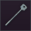 | W104 San | Health Resort west wing office room 104 key | Shoreline | `5a0dc45586f7742f6b0b73e3` |
| 93 |  | W112 San | Health Resort west wing office room 112 key | Shoreline | `5a0dc95c86f77452440fc675` |
| 94 |  | W203 San | Health Resort west wing room 203 key | Shoreline | `5a144dfd86f77445cb5a0982` |
| 95 |  | W205 San | Health Resort west wing room 205 key | Shoreline | `5a0ec6d286f7742c0b518fb5` |
| 96 |  | W207 San | Health Resort west wing room 207 key | Shoreline | `5a0ec70e86f7742c0b518fba` |
| 97 |  | W216 San | Health Resort west wing room 216 key | Shoreline | `5a0ee30786f774023b6ee08f` |
| 98 | 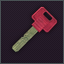 | W218 San | Health Resort west wing room 218 key | Shoreline | `5a13eebd86f7746fd639aa93` |
| 99 |  | W219 San | Health Resort west wing room 219 key | Shoreline | `5a13ef0686f7746e5a411744` |
| 100 |  | W220 San | Health Resort west wing room 220 key | Shoreline | `5a0ee34586f774023b6ee092` |
| 101 |  | W221 San | Health Resort west wing room 221 key | Shoreline | `5a0ee37f86f774023657a86f` |
| 102 |  | W222 San | Health Resort west wing room 222 key | Shoreline | `5a1452ee86f7746f33111763` |
| 103 |  | W301 San | Health Resort west wing room 301 key | Shoreline | `5a13ef7e86f7741290491063` |
| 104 |  | W303 San | Health Resort west wing room 303 key | Shoreline | `5a0eeb1a86f774688b70aa5c` |
| 105 |  | W306 San | Health Resort west wing room 306 key | Shoreline | `5a13f46386f7741dd7384b04` |
| 106 |  | W309 San | Health Resort west wing room 309 key | Shoreline | `5a0eeb8e86f77461257ed71a` |
| 107 |  | W321 safe | Health Resort west wing room 321 safe key | Shoreline | `5a0eff2986f7741fd654e684` |
| 108 |  | W323 San | Health Resort west wing room 323 key | Shoreline | `5a13ee1986f774794d4c14cd` |
| 109 |  | W325 San | Health Resort west wing room 325 key | Shoreline | `5a0eebed86f77461230ddb3d` |
| 110 | 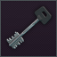 | HEPS | HEP station storage room key | Shoreline | `5d8e15b686f774445103b190` |
| 111 |  | House | Hillside house key | Lighthouse | `61a6444b8c141d68246e2d2f` |
| 112 |  | Toilet | Horse restaurant toilet key | Ground Zero | `658199a0490414548c0fa83b` |
| 113 |  | HO 1 | Housing office first floor safe key | – | `63a39e6acd6db0635c1975fe` |
| 114 |  | HO 2 | Housing office second floor safe key | – | `63a39e5b234195315d4020bf` |
| 115 |  | IDEA reg. | IDEA cash register key | Interchange | `5ad7242b86f7740a6a3abd43` |
| 116 |  | Iron gate | Iron gate key | Streets of Tarkov | `63a39f6e64283b5e9c56b289` |
| 117 | 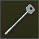 | Key 01 | Key 01 | The Labyrinth | `679baa2c61f588ae2b062a24` |
| 118 |  | Key 02 | Key 02 | The Labyrinth | `679baa4f59b8961f370dd683` |
| 119 | 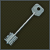 | Key 03 | Key 03 | The Labyrinth | `679baa5a59b8961f370dd685` |
| 120 |  | Key 04 | Key 04 | The Labyrinth | `679baa9091966fe40408f149` |
| 121 | 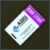 | Kruglov *(shared name)* | Keycard from Kruglov's safe | – | `67bdf0e67c1ef7a648043531` |
| 122 | 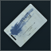 | Keycard | Keycard with a blue marking | The Lab | `5efde6b4f5448336730dbd61` |
| 123 | 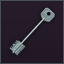 | KIBA inner | Kiba Arms inner grate door key | Interchange | `5addaffe86f77470b455f900` |
| 124 |  | KIBA outer | Kiba Arms outer door key | Interchange | `5ad5d7d286f77450166e0a89` |
| 125 | 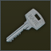 | Knossos | Knossos LLC facility key | Shoreline | `679b9716597ba2ed120c3d3f` |
| 126 | 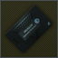 | Kruglov *(shared name)* | Kruglov's RFID keycard | – | `67bdea8667098e658f064695` |
| 127 | 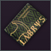 | Labrys | Labrys access keycard | The Lab | `679b9819a2f2dd4da9023512` |
| 128 |  | Labyrinth | Labyrinth key | The Labyrinth | `679bac1d61f588ae2b062a26` |
| 129 | 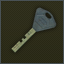 | Leon | Leon's hideout key | Lighthouse | `664d3de85f2355673b09aed5` |
| 130 | 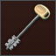 | Lighthouse | Lighthouse island stash key | Lighthouse | `6a8d581fe74010bf70069d83` |
| 131 | 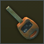 | Machinery | Machinery key | Customs | `5937ee6486f77408994ba448` |
| 132 |  | Merin | Merin car trunk key | Lighthouse | `61aa5b518f5e7a39b41416e2` |
| 133 |  | Checkpoint | Military checkpoint key | Customs | `5913915886f774123603c392` |
| 134 | 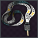 | Danex | Missam forklift key | – | `62a09ec84f842e1bd12da3f2` |
| 135 |  | MVD | MVD academy entrance hall guard room key | Streets of Tarkov | `6582dc4b6ba9e979af6b79f4` |
| 136 | 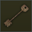 | Chek. 13 | Mysterious room marked key | Streets of Tarkov | `64ccc25f95763a1ae376e447` |
| 137 | 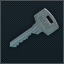 | Pharmacy | NecrusPharm pharmacy key | Interchange | `5ad5d64486f774079b080af8` |
| 138 | 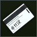 | #11SR | Object 11SR keycard | Interchange | `5e42c81886f7742a01529f57` |
| 139 | 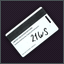 | #21WS | Object 21WS keycard | Interchange | `5e42c83786f7742a021fdf3c` |
| 140 | 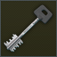 | Observe | Observation room key | The Labyrinth | `679baace4e9ca6b3d80586b2` |
| 141 |  | Depot | Old house room key | Woods | `6761a6ccd9bbb27ad703c48a` |
| 142 | 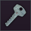 | Depot T. | Old house toilet key | Woods | `6939948dc2ceb9acd7082eb2` |
| 143 |  | OLI office | OLI administration office key | Interchange | `5ad5ccd186f774446d5706e9` |
| 144 |  | OLI reg. | OLI cash register key | Interchange | `5ad7217186f7746744498875` |
| 145 |  | OLI Log. | OLI logistics department office key | Interchange | `5ad5cfbd86f7742c825d6104` |
| 146 |  | OLI util. | OLI outlet utility room key | Interchange | `5ad5d20586f77449be26d877` |
| 147 |  | OR | Operating room key | Lighthouse | `62987da96188c076bc0d8c51` |
| 148 |  | PE | PE teacher's office key | Streets of Tarkov | `64ccc268c41e91416064ebc7` |
| 149 |  | Pier | Pier door key | Terminal | `6866adbe09b973bf45094339` |
| 150 |  | Pnwd 206 | Pinewood hotel room 206 key | Streets of Tarkov | `63a39f18c2d53c2c6839c1d3` |
| 151 |  | Pnwd 215 | Pinewood hotel room 215 key | Streets of Tarkov | `63a39f08cd6db0635c197600` |
| 152 | 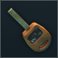 | Police | Police truck cabin key | Lighthouse | `61aa5aed32a4743c3453d319` |
| 153 |  | Bunkhouse | Portable bunkhouse key | Customs | `5938144586f77473c2087145` |
| 154 | 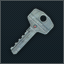 | Cabin *(shared name)* | Portable cabin key | Customs | `5780d07a2459777de4559324` |
| 155 |  | Power | Power substation utility cabin key | Interchange | `5ad5d49886f77455f9731921` |
| 156 | 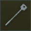 | Skybridge 46-48 | Primorsky 46-48 skybridge key | Streets of Tarkov | `63a39e1d234195315d4020bd` |
| 157 |  | Prim 48 | Primorsky 48 apartment key | Streets of Tarkov | `63a71eb5b7f4570d3a29316b` |
| 158 |  | Primorsky | Primorsky Ave apartment key | – | `6391fcf5744e45201147080f` |
| 159 |  | Pump Back | Pumping station back door key | – | `593858c486f774253a24cb52` |
| 160 |  | Pump Frnt | Pumping station front door key | – | `57a349b2245977762b199ec7` |
| 161 |  | Radar | Radar station commandant room key | Lighthouse | `62987c658081af308d7558c6` |
| 162 |  | RB-AK | RB-AK key | Reserve | `5d80c78786f774403a401e3e` |
| 163 |  | RB-AM | RB-AM key | Reserve | `5d80c88d86f77440556dbf07` |
| 164 |  | RB-AO | RB-AO key | Reserve | `5d80c66d86f774405611c7d6` |
| 165 |  | RB-BK | RB-BK marked key | Reserve | `5d80c60f86f77440373c4ece` |
| 166 |  | RB-GN | RB-GN key | Reserve | `5d8e3ecc86f774414c78d05e` |
| 167 |  | RB-KORL | RB-KORL key | Reserve | `5d8e0db586f7744450412a42` |
| 168 |  | RB-KPRL | RB-KPRL key | Reserve | `5d8e0e0e86f774321140eb56` |
| 169 |  | RB-KSM | RB-KSM key | Reserve | `5d947d4e86f774447b415895` |
| 170 |  | RB-MP11 | RB-MP11 key | Reserve | `5d80c93086f7744036212b41` |
| 171 |  | RB-MP12 | RB-MP12 key | Reserve | `5d80c95986f77440351beef3` |
| 172 |  | RB-MP13 | RB-MP13 key | Reserve | `5d80cbd886f77470855c26c2` |
| 173 |  | RB-MP21 | RB-MP21 key | Reserve | `5d80ca9086f774403a401e40` |
| 174 |  | RB-MP22 | RB-MP22 key | Reserve | `5d80cab086f77440535be201` |
| 175 |  | RB-OB | RB-OB key | Reserve | `5d80c6c586f77440351beef1` |
| 176 |  | RB-OP | RB-OP key | Reserve | `5d80c8f586f77440373c4ed0` |
| 177 |  | RB-ORB1 | RB-ORB1 key | Reserve | `5d80ccac86f77470841ff452` |
| 178 |  | RB-ORB2 | RB-ORB2 key | Reserve | `5d80ccdd86f77474f7575e02` |
| 179 |  | RB-ORB3 | RB-ORB3 key | Reserve | `5d80cd1a86f77402aa362f42` |
| 180 |  | RB-PKPM | RB-PKPM marked key | Reserve | `5ede7a8229445733cb4c18e2` |
| 181 |  | RB-PKPTS | RB-PKPTS key | Reserve | `68e9654d72488961110dbf69` |
| 182 |  | RB-PP | RB-PP key | – | `5d80cb8786f774405611c7d9` |
| 183 |  | RB-PSP1 | RB-PSP1 key | Reserve | `5d80cb3886f77440556dbf09` |
| 184 |  | RB-PSP2 | RB-PSP2 key | Reserve | `5d95d6fa86f77424484aa5e9` |
| 185 |  | RB-PSV1 | RB-PSV1 key | Reserve | `5d80cb5686f77440545d1286` |
| 186 |  | RB-PSV2 | RB-PSV2 key | Reserve | `5d95d6be86f77424444eb3a7` |
| 187 |  | RB-RH | RB-RH key | Reserve | `5da5cdcd86f774529238fb9b` |
| 188 |  | RB-RLSA | RB-RLSA key | Reserve | `5ede7b0c6d23e5473e6e8c66` |
| 189 |  | RB-RS | RB-RS key | Reserve | `5da46e3886f774653b7a83fe` |
| 190 |  | RB-SMP | RB-SMP key | Reserve | `5d947d3886f774447b415893` |
| 191 |  | RB-ST | RB-ST key | Reserve | `5d9f1fa686f774726974a992` |
| 192 |  | RB-TB | RB-TB key | Reserve | `5d80c6fc86f774403a401e3c` |
| 193 |  | RB-VO | RB-VO marked key | Reserve | `5d80c62a86f7744036212b3f` |
| 194 |  | REA | Real estate agency office room key | Streets of Tarkov | `6582dc5740562727a654ebb1` |
| 195 |  | Relax | Relaxation room key | Streets of Tarkov | `6582dbf0b8d7830efc45016f` |
| 196 |  | A.P. Blue | Reprogrammed keycard for A.P.'s apartment lock (Blue) | – | `68e7d984308332889e0b5e71` |
| 197 |  | A.P. Green | Reprogrammed keycard for A.P.'s apartment lock (Green) | Streets of Tarkov | `68c14b734a7e0bada00f8fd4` |
| 198 |  | A.P. Red | Reprogrammed keycard for A.P.'s apartment lock (Red) | – | `68e7d904aded99fd1a0624f2` |
| 199 |  | RFID Mr.K | Reprogrammed RFID keycard with Mr. Kerman's hash codes | Shoreline | `67c033fd0610e91bea056998` |
| 200 |  | RFID Prap. | Reprogrammed RFID keycard with Prapor's hash codes | Shoreline | `67c04a6f9152fbdfa306cc66` |
| 201 |  | Reshala | Reshala's bunkhouse key | Customs | `68e95f4fa4a577e907015787` |
| 202 |  | RFID L. | RFID keycard with unknown name | Shoreline | `67c04dac9320f644db06f45c` |
| 203 |  | Barrack | Rogue USEC barrack key | Lighthouse | `62a9cb937377a65d7b070cef` |
| 204 |  | Stash | Rogue USEC stash key | Lighthouse | `61a64492ba05ef10d62adcc1` |
| 205 |  | Workshop | Rogue USEC workshop key | Lighthouse | `61aa81fcb225ac1ead7957c3` |
| 206 |  | Rus Post | Rus Post car key | Streets of Tarkov | `68e63b56ad8cba49190ea529` |
| 207 |  | Rusted | Rusted bloody key | Streets of Tarkov | `64d4b23dc1b37504b41ac2b6` |
| 208 |  | Security | Security post key | Customs | `6aa2f73005eae7bedb0ad83e` |
| 209 |  | Shatun | Shatun's hideout key | Woods | `664d3db6db5dea2bad286955` |
| 210 |  | SSK | Shturman's stash key | Woods | `5d08d21286f774736e7c94c3` |
| 211 |  | SMW | SMW car key | Shoreline | `5a0eb38b86f774153b320eb0` |
| 212 |  | Stairs | Stair landing key | Streets of Tarkov | `63a39fd1c9b3aa4b61683efb` |
| 213 |  | 14-4 rst. | Station 14-4 KORD Arshavin K. pass (Restored) | Interchange | `68cc09872bdcc15c010c2668` |
| 214 |  | Store *(shared name)* | Store manager's key | Streets of Tarkov | `63a39c69af870e651d58e6aa` |
| 215 |  | Safe *(shared name)* | Store safe key | – | `5a0f075686f7745bcc42ee12` |
| 216 |  | Substation | Substation marked key | Lighthouse | `62987dfc402c7f69bf010923` |
| 217 |  | Supp. | Supply department director's office key | Streets of Tarkov | `63a39ce4cd6db0635c1975fa` |
| 218 |  | Tarbank | Tarbank cash register department key | Streets of Tarkov | `64ccc2111779ad6ba200a139` |
| 219 |  | Director's | Tarcone Director's office key | Customs | `5780d0532459777a5108b9a2` |
| 220 |  | TG apt. | TerraGroup corporate apartment key | Streets of Tarkov | `67ee7680562d5057e60ccc3a` |
| 221 |  | Access | TerraGroup Labs access keycard | The Lab | `5c94bbff86f7747ee735c08f` |
| 222 |  | TGL ASR | TerraGroup Labs arsenal storage room key | The Lab | `5c1f79a086f7746ed066fb8f` |
| 223 |  | Black | TerraGroup Labs keycard (Black) | The Lab | `5c1d0f4986f7744bb01837fa` |
| 224 |  | Blue | TerraGroup Labs keycard (Blue) | The Lab | `5c1d0c5f86f7744bb2683cf0` |
| 225 |  | Green | TerraGroup Labs keycard (Green) | The Lab | `5c1d0dc586f7744baf2e7b79` |
| 226 |  | Red | TerraGroup Labs keycard (Red) | The Lab | `5c1d0efb86f7744baf2e7b7b` |
| 227 |  | Violet | TerraGroup Labs keycard (Violet) | The Lab | `5c1e495a86f7743109743dfb` |
| 228 |  | Yellow | TerraGroup Labs keycard (Yellow) | The Lab | `5c1d0d6d86f7744bb2683e1f` |
| 229 |  | TGL MO | TerraGroup Labs manager's office room key | The Lab | `5c1e2a1e86f77431ea0ea84c` |
| 230 |  | Res. unit | TerraGroup Labs residential unit keycard | The Lab | `6711039f9e648049e50b3307` |
| 231 |  | TGL WT | TerraGroup Labs weapon testing area key | The Lab | `5c1e2d1f86f77431e9280bee` |
| 232 |  | TG meeting | TerraGroup meeting room key | Streets of Tarkov | `64ccc206793ca11c8f450a38` |
| 233 |  | Science | TerraGroup science office key | Ground Zero | `658199aa38c79576a2569e13` |
| 234 |  | TG arm. | TerraGroup security armory key | Streets of Tarkov | `64ccc24de61ea448b507d34d` |
| 235 |  | Polikhim | TerraGroup storage room keycard | Factory | `66acd6702b17692df20144c0` |
| 236 |  | Torture | Torture room key | The Labyrinth | `679baae891966fe40408f14c` |
| 237 |  | Cabin *(shared name)* | Trailer park portable cabin key | Customs | `5913611c86f77479e0084092` |
| 238 |  | ULTRA med. | ULTRA medical storage key | Interchange | `5e42c71586f7747f245e1343` |
| 239 |  | Utility | Underground parking utility room key | Ground Zero | `658199972dc4e60f6d556a2f` |
| 240 |  | UC arch. | Unity Credit Bank archive room key | – | `6582dc63cafcd9485374dbc5` |
| 241 |  | UC reg. | Unity Credit Bank cash register key | Ground Zero | `6581998038c79576a2569e11` |
| 242 |  | Unknown | Unknown key | Customs | `593962ca86f774068014d9af` |
| 243 |  | USEC 1 | USEC cottage first safe key | Lighthouse | `61aa5b7db225ac1ead7957c1` |
| 244 |  | USEC cott. | USEC cottage room key | Lighthouse | `66265d7be65f224b2e17c6aa` |
| 245 |  | USEC 2 | USEC cottage second safe key | Lighthouse, Streets of Tarkov | `61aa5ba8018e9821b7368da9` |
| 246 |  | USEC | USEC stash key | Customs | `5da743f586f7744014504f72` |
| 247 |  | Wheel | Valve handwheel | The Labyrinth | `678fa929819ddc4c350c0317` |
| 248 |  | Shestyorka | VAZ car key | Customs | `5913651986f774432f15d132` |
| 249 |  | Voron | Voron's hideout key | Shoreline | `664d3ddfdda2e85aca370d75` |
| 250 |  | WTP store | Water treatment plant storage room key | Lighthouse | `62987e26a77ec735f90a2995` |
| 251 |  | WSafe | Weapon safe key | – | `59148f8286f7741b951ea113` |
| 252 |  | Safe *(shared name)* | Weather station safe key | Shoreline | `5a0f006986f7741ffd2fe484` |
| 253 |  | X-ray | X-ray room key | Streets of Tarkov | `64ccc246ff54fb38131acf29` |
| 254 |  | Yotota | Yotota car key | – | `591ae8f986f77406f854be45` |
| 255 |  | ZB-014 | ZB-014 key | Woods | `591afe0186f77431bd616a11` |
| 256 |  | ZB-1013 | ZB-1013 key | Customs | `6aa2f6565d82e97ee9076820` |
| 257 |  | Zm apt. 8 | Zmeisky 3 apartment 8 key | Streets of Tarkov | `63a39dfe3901f439517cafba` |
| 258 |  | Zm. 3 | Zmeisky 3 apartment key | Streets of Tarkov | `68e960db934bf7b02d005dab` |
| 259 |  | Zm apt. 20 | Zmeisky 5 apartment 20 key | Streets of Tarkov | `63a39df18a56922e82001f25` |
